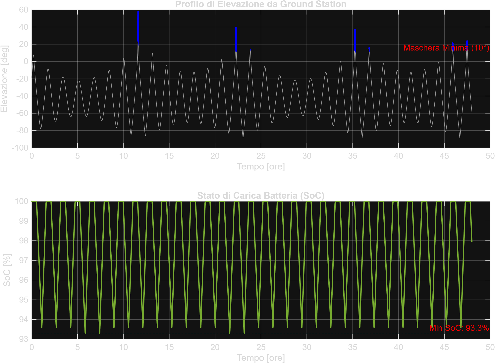

# Autonomous CubeSat Mission Analysis & EPS Power Budget Pipeline

Automated mission analysis pipeline coupling **MATLAB** with **NASA General Mission Analysis Tool (GMAT)** in batch mode. 

The pipeline performs high-precision LEO numerical orbit propagation ($J_2$, MSISE-90 atmospheric drag, lunisolar third-body perturbations, and solar radiation pressure), evaluates Ground Station contact windows, analyzes eclipse states, and simulates the onboard Electrical Power Subsystem (EPS) battery state of charge (SoC).

---

## Mission Parameters & Architecture

| Parameter | Value | Description |
| :--- | :--- | :--- |
| **Orbit Regime** | LEO Sun-Synchronous (SSO) | Altitude: ~500 km ($a = 6878.14\text{ km}$, $e = 0.001$, $i = 97.4^\circ$) |
| **Spacecraft Class** | 3U CubeSat | Mass: $4.0\text{ kg}$, $C_d = 2.2$, $A_{drag} = 0.03\text{ m}^2$ |
| **Ground Station** | Northern Italy (Vicenza) | Lat: $45.66^\circ\text{ N}$, Lon: $11.40^\circ\text{ E}$, Elevation Mask: $10^\circ$ |
| **Battery (EPS)** | Li-Ion / NMC | Nominal Capacity: $40.0\text{ Wh}$, Power Generation (Sun): $12.0\text{ W}$ |

---

## Simulation Results

### Key Performance Deliverables (48h Horizon):
* **Illumination Breakdown:** Sunlight: **63.3%** | Umbra: **36.2%** | Penumbra: **0.5%**
* **EPS Battery Integrity:** Minimum State of Charge: **93.3%** (Maximum Depth of Discharge: **6.7%**, well within the safe 20–30% threshold for long-term LEO battery life).
* **Ground Station Access:** 7 valid contact passes above the $10^\circ$ elevation threshold, with contact durations ranging from $1.5$ to $6.2$ minutes and maximum elevation up to $58.5^\circ$.

---

## Quickstart & Requirements

1. **Prerequisites:**
   * MATLAB (R2021a or newer recommended).
   * NASA GMAT (R2022a / R2026a) with `GmatConsole.exe` available.
2. **Setup:**
   * Clone this repository.
   * Verify the `gmat_bin_path` in `run_gmat_batch.m` matches your local GMAT installation path.
3. **Execution:**
   * Run `run_gmat_batch` in the MATLAB Command Window.
